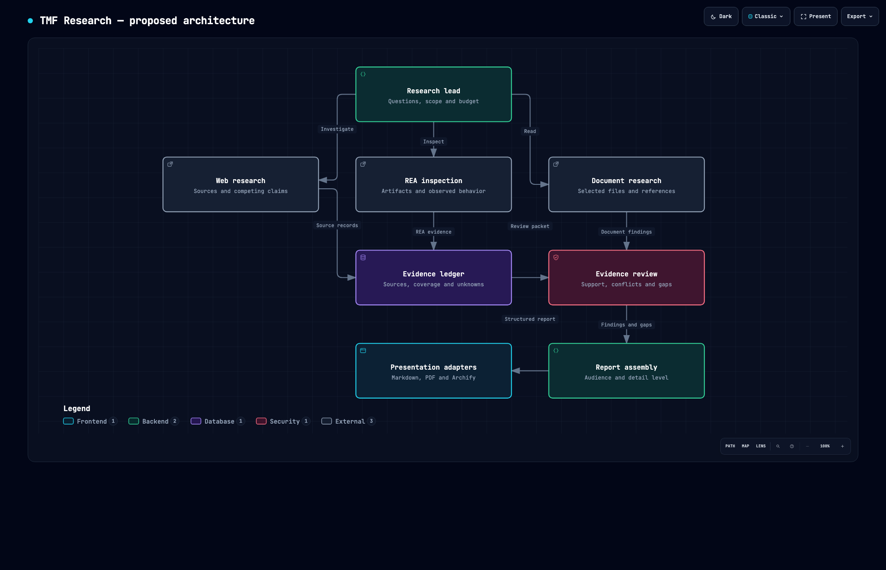
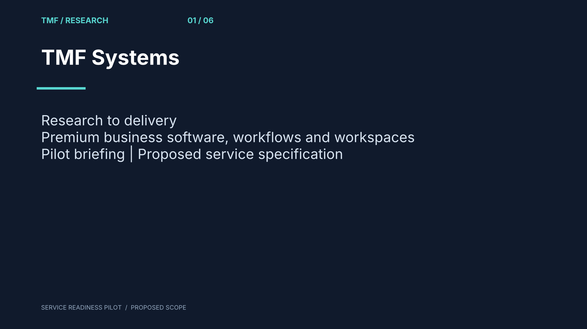

# TMF Research

[](https://github.com/acratt13/tmf-research/actions/workflows/test.yml)

**Research the system. Inspect the software. Keep the evidence.**

An open workbench for turning research and software inspection into useful, traceable specifications—not just another long answer.

**Early foundation release.** The evidence/report CLI below works. Autonomous research agents, live web retrieval, the application UI and editor integrations are **not implemented yet**. This is not a finished Perplexity alternative.



## Try it in one minute

Python 3.11+. Core commands have no third-party Python runtime dependencies.

```bash
git clone https://github.com/acratt13/tmf-research.git
cd tmf-research
python -m tmf_research validate examples/report.json
python -m tmf_research render examples/report.json --format md --output runs/report.md
python -m tmf_research render examples/report.json --format html --output runs/report.html
```

Open `runs/report.html` in your browser. Existing output files are protected from silent replacement; choose a new output name when regenerating.

The [example report](examples/report.md) uses an original synthetic payment-allocation fixture, not private client material or a claim about a commercial product. Compare the same record as [PDF](examples/report.pdf), [HTML](examples/report.html) or [JSON](examples/report.json).

Optional PDF export:

```bash
python -m pip install '.[pdf]'
python -m tmf_research render examples/report.json --format pdf --output runs/report.pdf
```

Use `--audience executive` for a shorter view. Caveats, unknowns and the evidence register remain in both views. PDF currently uses ReportLab's default core fonts; complex-script/complete Unicode typography is not established.

## Actual Office-engine trial

WordCraft, GridCraft and DeckCraft v0.8.0 created, reopened, edited and exported an original service-readiness briefing. [See the trial and download DOCX/XLSX/PPTX/PDF outputs](docs/CRAFT-TRIAL.md). This is a reproducible local engine test, not an implemented autonomous research pipeline.



## Real REA integration

[REA](https://github.com/morluto/rea) is an independent open-source reverse-engineering project. Install/build it using its own instructions. TMF Research calls the actual CLI and retains its evidence envelope; it does not replace the engine.

With `rea` on your PATH:

```bash
python -m tmf_research inspect examples \
  --operation analyze-javascript-application \
  --output runs/rea.json
python -m tmf_research import-rea runs/rea.json \
  --title 'Payment fixture inspection' \
  --output runs/rea-report.json
python -m tmf_research render runs/rea-report.json \
  --output runs/rea-report.md
```

For a source checkout, supply `--rea-command '["node", "/path/to/rea/scripts/rea.mjs"]'`. No shell evaluates this command prefix. Supported operations: `inspect-managed-artifact`, `inspect-managed-members`, `analyze-javascript-application`. Default timeout: 60 seconds, configurable up to 300.

Import deliberately starts with **zero asserted findings** and partial/unreviewed evidence. Read the original result, coverage and limitations before writing domain claims. REA returning a process exit code of zero is not proof of complete inspection. A static SDK field is not an executed workflow.

## What exists today

| Capability | Status |
| --- | --- |
| Report contract and source-reference validation | Implemented; structural checks only |
| Finding labels: documented / observed / inferred / proposed / unknown | Implemented |
| Markdown and escaped, self-contained HTML | Implemented and generated/read locally |
| PDF | Implemented via optional ReportLab; generated, text-read and first page visually reviewed |
| Explicit local REA invocation and conservative import | Implemented; real JavaScript fixture inspection run with REA 6.7.0 |
| Proposed architecture diagram | Generated with Archify; artifact and bounded desktop-browser checks passed |
| Planner, researcher, reviewer and writer agent team | Specified; not implemented |
| Iterative web search/fetch and source comparison | Specified; not implemented |
| Archify runtime/export adapter | Not implemented; current diagram was authored separately |
| WordCraft / GridCraft / DeckCraft outputs | Reproducible local CLI trial passed; integrated runtime adapters and native GUI still unimplemented/untested |
| GUI, hosted multi-client service and automatic KB ingestion | Not implemented |

The validator checks required fields, reference integrity, evidence availability and visible partial-source caveats. **It cannot establish whether a claim is true or entailed by a source.**

## Where this is headed

A lead researcher coordinates bounded specialists for web research, selected documents, REA inspection, evidence review and report assembly. They share a versioned evidence ledger. Presentation adapters produce executive briefs, detailed research, build specifications and diagrams from the same structured record.

- [Actual Craft trial and editable output files](docs/CRAFT-TRIAL.md)
- [Open-source Office adapter comparison](docs/OFFICE-ADAPTERS.md)
- [Research workbench specification](docs/RESEARCH-WORKBENCH-SPEC.md)
- [Professional services specification](docs/SERVICE-SPEC.md): 14 offer families, delivery requirements, acceptance, support and assurance applicability
- [Interactive architecture](docs/architecture.html): download and open locally
- [Contribution guide](CONTRIBUTING.md)
- [Security and privacy boundaries](SECURITY.md)

Useful first contributions: report-contract edge cases, citation-preserving exports, source/provenance adapters, or a bounded search→review→spec vertical slice. Start with an issue for larger architecture changes. No fake provider-success paths or production claims based on fixtures.

## Verification

```bash
python -m unittest discover -s tests -v
node examples/check-payment.mjs  # optional: exercise the original JS fixture
```

Initial local evidence: 12 report/validation tests, four synthetic JavaScript assertions, an actual REA inspection (two JavaScript files parsed; none skipped; no parse failures), and generated Markdown/HTML/PDF with PDF text readback. These are bounded checks, not a full research-agent benchmark. See [verification notes](docs/VERIFICATION.md).

## Credits and license

MIT for original TMF Research code. [REA](https://github.com/morluto/rea) supplies the external inspection engine. [Archify](https://github.com/tt-a1i/archify) generated the proposed architecture viewer. See [third-party notices](THIRD_PARTY_NOTICES.md). No affiliation with Perplexity, Adobe or Microsoft is implied.
