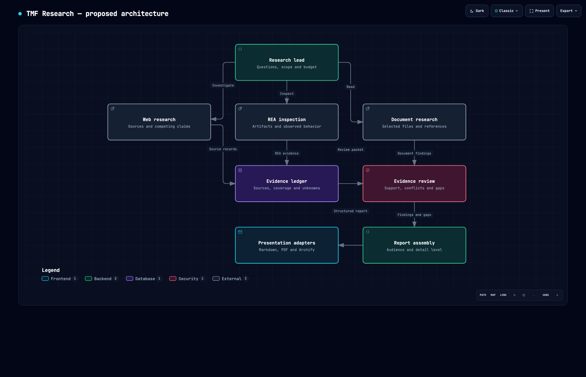
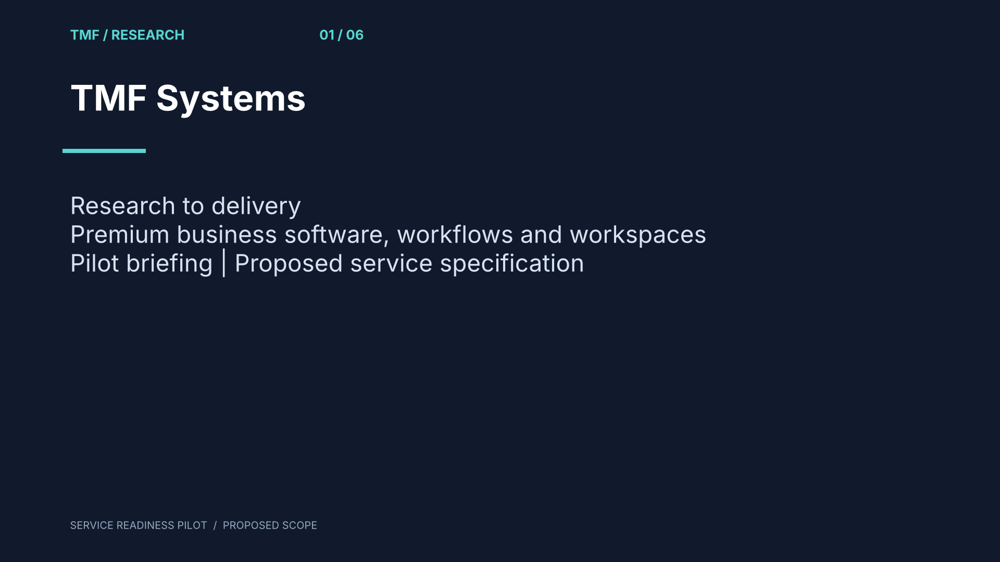

# TMF Research

[](https://github.com/acratt13/tmf-research/actions/workflows/test.yml)

**Research the system. Inspect the software. Keep the evidence.**

An open workbench for turning research and software inspection into useful, traceable specifications—not just another long answer.

**Local workbench, early release.** TMF Council connects a research lead, source scout, specialist investigations, real REA inspection, evidence review, critical perspectives, follow-up research and selected exports. Roles are separate bounded calls through the user's installed Codex CLI, not independent human experts. Read the [setup, evidence boundaries and live-run verification](docs/WORKBENCH.md). This is not a hosted service or a proven improvement over ordinary search.

The [intelligence and production bundle](docs/INTELLIGENCE-PRODUCTION-BUNDLE.md) keeps the full scope together: collection, design, professional software, client intelligence, knowledge, documents and MC handoffs, with explicit evidence boundaries.

See [what works today and the delivery roadmap](docs/ROADMAP.md) for the path to specialized documents, prospect intelligence, RAG-ready knowledge packs and Mission Control integration.



## Try it in one minute

For the research workspace, use Python 3.11+ and an authenticated Codex CLI providing the [required isolation features](docs/WORKBENCH.md#start). Compatibility is checked by those declared, non-deprecated features, not an exact version pin; a missing feature is refused by name.

```bash
python3 -m tmf_research serve
# Open http://127.0.0.1:8765
```

Choose any combination of **Understand / Compare / Build / Audit / Offer a service**. Choose depth and outputs, review the brief, then start. The **TMF Service Blueprint** preset selects all lenses and formats. Optional Craft/Archify exports and REA targets require local operator configuration; missing engines produce explicit partial results. Start with Markdown, HTML and the builder package for a dependency-free presentation path.

For command-line research, see [example brief](examples/research-brief.json) and [configuration](examples/workbench-config.json). Run files and evidence stay under ignored `runs/` by default. Selected brief, public passages and local REA excerpts are sent to the model provider; select only material you intend to share.

### Pre-build preset (a builders' workstream, before it is built)

`{"preset": "pre-build", "question": "...", "workstream": {"id", "ticket", "goal", "whoFor", "existing": [], "references": [], "constraints": [], "unknowns": []}}`. The preset decides the rest, so a launcher passes the preset only: quick depth, builder + Markdown outputs, and the Workstream Council (systems, full-stack, design, customer, challenger and a Canon keeper that checks the spec against `workstream.existing`; `"council": false` turns it off). REA runs only when the brief names `inspections` (tearing down an existing app or site).

Research reaches every crawler through a plugin's own MCP server. Sources come from a parallel **Crawlee swarm** on the installed remote worker: one bounded job per site (`crawlee_start` / `crawlee_status` / `crawlee_read` / `crawlee_pack` through `plugins/crawlee/mc-plugin/bridge.mjs`). Configure it with `{"crawlee": {"connection": "/absolute/private/connection.json"}}` in the workbench config. Sites the Crawlee worker could not collect go to the **Scrapling plugin** (`plugins/scrapling`: robots.txt honoured, no challenge solving), and every source records which crawler and fetcher collected it. There is no public-web fallback: with no Crawlee the run fails and says why; an unavailable Scrapling plugin is reported by name.

The result adds `pre_build` (`mc-pre-build/1`): the workstream spec doc in chapters (summary, what-exists, research, requirements, design, build-1..n, proof), its sources, unknowns, artifacts and the Crawlee provenance (job ids, source hashes). Research writes the doc; the builders review it and cut the tickets. A run is `completed` only with the spec and Crawlee-collected sources; otherwise it is `partial` or `failed` with the reason.

### Short workbench lifecycle commands

The workbench above remains the only job owner. These commands contact that running service and exit promptly; they do not launch another worker or run the model inside a tool call. The operator can set `TMF_RESEARCH_URL` to another `http://127.0.0.1:<port>` before launching the CLI. Actors cannot select configuration, credentials, a service URL or executable through command arguments.

```bash
python3 -m tmf_research status
python3 -m tmf_research submit --request-id example-intake-001 --brief-json '{"question":"What makes webhook intake reliable?","depth":"quick","formats":["md","html"],"council":false}'
python3 -m tmf_research status --id <returned-run-id>
python3 -m tmf_research result --id <returned-run-id>
python3 -m tmf_research cancel --id <returned-run-id>
```

Reuse the **same request ID and brief** after a lost response. It returns the same saved run, including cancelled, failed or interrupted runs; it never automatically restarts work. A different brief with that ID, or a different request while a job is active, is refused. Cancellation reports `cancelling` until the existing worker stops. Standalone `run`, `refine` and `serve` behavior is retained. Operator-managed provider authentication stays with the workbench; the CLI holds its local workbench token in memory only.

Status/results are valid JSON envelopes containing a bounded text range of the original JSON document, its `content_type`, character cursor, total length and SHA256. Continue with `--cursor <next_cursor> --sha256 <sha256>`; a changed document is refused instead of mixing revisions. `next_cursor:null` is the end. Reassemble `text` ranges before parsing that document. The complete MCP result (including `isError`, the pretty-printed CLI response and the existing text wrapper) stays within 2400 bytes; an HTTP read is capped at 8 MiB. Larger originals remain with Research. Result references name the original exports; partial, failed, withheld and interrupted evidence is not upgraded into success.

The packaged `tmf_research/mc/mcp-servers.json`, `mc/allow.json` and `mc/tool-annotations.json` are standard metadata inputs for MC's existing generic CLI wrapper/install owner: the original four lifecycle commands plus publish, missions, pause, resume and knowledge; status/result/missions/knowledge read-only, the other commands mutating. They are **not** a new MCP server or transport and do not establish an installed connection by themselves. The shared CLI shim belongs to MC, not this repository. The declared invocation ends in `-- tmf-research`, the console entry in `pyproject.toml`; its generated names are `tmf-research_submit`, `tmf-research_status`, `tmf-research_result` and `tmf-research_cancel`. Apply the declaration and matching annotations together instead of substituting an automatically recognized launcher. The wrapper source is supplied by the existing MC import owner, not copied into Research source. Applying those inputs, repairing its generic wrapped-help parser, role/profile grants, governed tool execution and installed acceptance are the separate MC integration slice. No model job, provider compatibility or installed MC acceptance is claimed by these CLI tests.

Each run's private `role-calls.json` retains effective role inputs (after passage selection) before dispatch and raw returned values before role-specific normalization. Input/output SHA256 fields identify the original serialized values; `*_redacted:true` means the existing credential filter changed the saved snapshot, so it is not an exact replay. These artifacts can contain selected source/document text: keep them private. Timeout state and report consumers remain unchanged; no automatic replay occurs.

### Canon candidates (bounded expansion slice)

The workbench can save a finished report with **Save candidates to Canon**. This is an explicit action, not automatic knowledge promotion. The existing `result` operation includes its publication receipt; `submit`, `status`, `result` and `cancel` keep their current contracts. Publication runs asynchronously under the existing workbench owner and can be cancelled. Research status stays separate from publication status.

Operator configuration (passed to `serve --config`) adds:

```json
{"canon":{"url":"http://127.0.0.1:4320","identity_scope":"workspace-stable-id","token_env":"MC_CANON_TOKEN"}}
```

The named environment variable must be supplied privately by the existing MC authorization owner. Its value never belongs in configuration or run artifacts. Source/model inputs cannot select a connection, identity scope or credential. No credential discovery, new transport, dependency or database is added. Unconfigured authorization, denied writes and unavailable Canon remain visible. The MC installation still needs its normal authorized connection provisioning; this source change does not install or enable a live binding.

The adapter uses Canon's existing `POST /api/canon/sections/knowledge/entries` keyed create and compare-and-set edit contracts. The Knowledge section must already exist. Entry `fields.status=draft` and `fields.reviewStatus=candidate` mark every output; section entries do not have a top-level draft status in this API. No entry becomes an approved operating rule.

Stable namespace + run ID identifies a mission. Conservative URL normalization (host case, default port, empty root path and fragments only) or an artifact hash identifies a source. A source identity is reused across missions within that namespace; immutable observation snapshots retain retrieval date, content hash, scope and limitations. Findings retain evidence labels, caveats, exact source revisions and any matching retained model reviews. Typed links use Canon's registered `source`, `supported-by` and `related` kinds. A report snapshot preserves the original report and output references; the mission head advances using Canon revisions. Retrying after a lost response reuses remote keyed identities even if its local receipt was lost. Reviewed or externally edited candidates are not overwritten.

`published-candidate` means the candidate writes were read in Canon's responses, not that the findings are independently verified. `partial`, `unavailable`, `cancelled` and `interrupted` expose incomplete publication. After a process restart, no automatic writes or research replay occurs; an explicit retry resolves existing identities. Local receipts are diagnostic artifacts in the existing run directory, not another knowledge store.

Current limits: identity resolution reuses this adapter's stable source keys; it does not merge arbitrary pre-existing company/person/source records or guess URL aliases. Cross-client namespace and connection provisioning belong to MC. Approval/promotion, actual Hub role deployment, recurring missions, graph Canvas views and distributed workers remain outside this slice. Draft expertise and structured profession/person outputs are implemented as described below. Output references identify the existing run and export name, and require the original Research service/storage to resolve; they are not uploaded copies.

MC Canvas handoff: the existing MC overlay already declares `mcpService: workbench` and `frame: view`; it shares one service with the tools and has no card stop action. Research uses its existing UI inside that dynamic Canvas application. Agents/builders drive jobs through the four lifecycle tools and show the application through existing `open_app` / `put_on_screen`. The Research UI now accepts a validated `?run=<saved-run-id>` to open the exact submitted job without starting another one. The MC-owned app card must allow `query: ["run"]` so `open_app {name: "tmf-research", query: {run: "<id>"}}` reaches that view; no replacement renderer is needed. The inspected baseline card does not yet allow this query. The matching MC overlay/card is installed through its existing owner; source-only checks do not establish installed acceptance. Candidate publication is exposed by the mutating `publish` companion tool; mission discovery and scoped Canon reads use `missions` and `knowledge`. `pause` and `resume` control an active job without another job owner. Popup close/reopen, pin persistence, chat-switch placement and agent/builder end-to-end acceptance require the MC owner’s installed test, and are not established by the browser proof below.

Actual module inventory for Super MC Machine Phase 0:

| Existing owner | Current contract / coverage | Expansion boundary |
| --- | --- | --- |
| `engine.py` / `RunStore` | Durable runs, stable request IDs, interrupted recovery; lifecycle and engine tests | Reused, no replacement scheduler |
| `providers.py`, crawler plugins | Source search/fetch, Crawlee jobs, Scrapling fallback and provenance; provider/pre-build/plugin tests | No crawler changes |
| `engine.py` review / Council | Claim admission, reviewer decisions, synthesis withholding, Council perspectives; evidence/Council tests | Retained labels, not independent certification |
| `cli.py`, `exports.py` | Validated reports, retained evidence, presentation exports; report/export tests | Original result remains available |
| `server.py`, `client.py`, `mc/*.json`, `web/` | Workbench job owner, four short CLI operations, paged hashes, UI; server/lifecycle/shared-shim tests | Explicit candidate publish action + receipt |
| `canon.py` | Existing Canon keyed section API, typed links and revisions; candidate/native-contract tests | New narrow adapter; no authority store |

Before this slice there was a Council role named Canon keeper, but no Canon write adapter in the Research source. Live MC connection health is an installation concern and was not re-probed here; the reported installed v0.4 workbench baseline is distinct from these source changes. Business mission presets, role/Hub generation, reusable Council configurations, ontology extraction and distributed execution remain future integration work.

### Structured research missions

`missions` returns the versioned catalog without starting a model. Supply a mission through the existing `submit --brief-json` operation:

```json
{"question":"Investigate this public company before a consultation","depth":"quick","council":false,"formats":["md","builder"],"mission":{"schema":"tmf-research-mission/1","type":"company","target":"Example company","scope":"Public operations only; internal needs remain unknown","collection":"plugins","permitted_domains":["example.com"],"budgets":{"sources":4,"calls":18,"rounds":0,"concurrency":2},"completion_criteria":["A sourced consultation briefing with explicit gaps"]}}
```

Mission types are configurations of the existing engine: general, technology, company, startup, leads, market, profession, person and council. Company/startup/lead/market missions prefer the existing crawler plugins; `collection: web` explicitly selects the existing bounded HTTPS adapter. Domain allow/exclude lists apply to acquired source and redirect URLs. Budgets name source/model-call counts, follow-up rounds and concurrency. These are not hard monetary or OS resource budgets.

Business missions produce `intelligence.json`: deduplicated company-domain identities, the eleven consultation sections, evidence-linked inferred lead opportunities, or market sections. Profession missions produce sourced knowledge domains and a draft expertise definition; person missions produce explicitly labeled professional simulation research plus a separate generic expertise draft. Every substantive section points to retained reviewed finding IDs. Unsupported structured output is withheld and the report remains partial. Unknown required sections remain visible and keep the mission partial. Model review is not independent factual verification.

A custom Council mission supplies distinct specialists as `{name, responsibilities}`. They execute through the existing Council loop, not a new agent runtime. The configuration and actual perspectives are retained and can be published to Canon. Specialist instructions and capability requirements are proposals, never grants or worker identities.

`publish --id <run-id>` returns promptly and saves candidates asynchronously. Read its progress through `status` (`canon_activity`) and `result` (`canon` receipt). `pause --id` stops new research stages; already-started bounded provider operations may finish. `resume --id` continues the same paused controller, or explicitly resumes an eligible interrupted run from its durable execution checkpoint. Completed stages and matching retained model results are reused; brief and evidence hashes are checked first. Incomplete provider calls may be retried within the original call budget, with the retry visible in the run history. Interrupted external collection, inspection and export stages remain ineligible until recovery is established. Older runs without checkpoints remain readable. Closing/reopening the popup does not perform either operation; a process restart never automatically resumes work.

Canon publication now writes company-domain identities and investigation/lead candidates, independent professional-knowledge entries, a collection containing their exact revision references, and specialty drafts referencing the collection. Different workers can `knowledge --id <canon-id> --revision <revision>` to read the same revision. Reads are limited to this Research connection's stable namespace; they cannot retrieve arbitrary private Canon records through Research. A mission can reuse up to twelve such exact `knowledge_refs` as source evidence; missing connections or revisions fail visibly before a model starts. Existing MC Canon tools remain the route to other authorized knowledge.

MC can supply the Canon configuration through its existing operator-owned plugin environment: `TMF_RESEARCH_CANON_URL`, `TMF_RESEARCH_CANON_SCOPE`, `TMF_RESEARCH_CANON_AUTH`, `TMF_RESEARCH_CANON_AUTHOR` and, for bearer mode, `TMF_RESEARCH_CANON_TOKEN_ENV` (a name). Explicit config-file values take precedence. The default bearer mode never falls back to another authority on a refusal. `auth: local-system` is an explicit configuration for Canon's existing trusted loopback system API (`serviceIdentity.ts` and `tmf.canonSections`), with author attribution; it requires no copied operator credential. It is unavailable on a backend requiring bearer authorization. No remote URL, credential discovery or new auth route is introduced.

### Company and lead continuity

Business intelligence now binds a company website to retained factual findings from that website, rather than accepting a model-supplied domain alone. Website case, one trailing DNS dot and the usual single `www` host variant normalize to one domain identity; this is not independent corporate-ownership verification. Sources and retrieval dates stay with the supporting findings. Lead opportunities, proposed services and fit remain inferences, with assumptions and unknowns separate from the source facts. Lead missions may supply `industry` and `geography`; the form exposes both.

Company briefings retain all eleven consultation sections. Startup briefings add explicit founders/leadership, product/technology, funding, investors/accelerators, business model, partnerships, public traction, hiring/expansion and programs/opportunities sections. Missing evidence becomes an unknown section and a partial mission, not guessed funding or traction. The structured briefing is included in readable report exports and the builder pack as well as `intelligence.json`.

The existing read-only operation also accepts:

```sh
python3 -m tmf_research knowledge --company example.com
```

It retrieves this connection's existing company identity and a bounded set of linked investigations, with exact Canon revisions. A new investigation uses those records to retain literal research-description comparisons. Changed wording is not proof of a changed business operation. The lookup reads at most 30 backlinks and returns up to three observations; truncation is explicit, so it does not promise a complete or globally latest history. Missing Canon configuration stays visibly unavailable. A missing company is returned as not found without creating a record.

Publication reuses one company identity, including an unambiguous legacy `www` identity. Two already-distinct identities require review; they are never silently merged. Each run has a stable revisioned company/lead head plus immutable observations and exact finding-revision references. Repeat publication reuses the same candidates. Changes to one run advance its owned candidate revision; reviewed or human-edited content is protected. Previous research references are frozen in the output so publication retries do not silently change its comparison baseline. No outreach or CRM authority is added.

The full-spec boundary remains explicit:

| Spec phase | Source implementation / current limit |
| --- | --- |
| 0 audit | Actual module, contract and test inventory above |
| 1 MC integration | Existing one-service overlay and dynamic view; expanded tool metadata and exact-run navigation; installed proof recorded separately |
| 2 Canon/graph | Stable identities, revisions, typed links, candidates, exact-revision reads; arbitrary pre-existing identity merging and graph UI not implemented |
| 3 business intelligence | Structured company/startup/lead/market missions, evidence checks and deduplication; official-host evidence binding, explicit startup sections, qualified lead evidence and scoped prior-investigation comparison; real-subject quality needs live evidence review |
| 4 bounded workers | Existing crawler/Council execution, budgets, durable remote job references and cancellation; no new scheduler, remote worker pause/recovery not established |
| 5 professional knowledge | Independent sourced Canon entries and shared versioned collections; updates remain candidates |
| 6 roles/agents | Draft expertise with shared knowledge references and evaluation requirements; actual Hub role-socket import, worker creation and evaluation not connected |
| 7 councils | Custom responsibilities on the existing Council with saved reusable configurations; no automatic agent deployment |
| 8 persons | Labeled public-professional research and generic expertise drafts; private-person consent required; no voice/personality runtime or deployed simulation |
| 9 distributed scale | Not implemented; existing authorized runtime/worker contracts must be used |

### Existing evidence/report commands

Python 3.11+. Core commands have no third-party Python runtime dependencies.

```bash
git clone https://github.com/acratt13/tmf-research.git
cd tmf-research
python -m tmf_research validate examples/report.json
python -m tmf_research render examples/report.json --format md --output runs/report.md
python -m tmf_research render examples/report.json --format html --output runs/report.html
```

Open `runs/report.html` in your browser. Existing output files are protected from silent replacement; choose a new output name when regenerating.

The [example report](examples/report.md) uses an original synthetic payment-allocation fixture, not private client material or a claim about a commercial product. Compare the same record as [PDF](examples/report.pdf), [HTML](examples/report.html) or [JSON](examples/report.json).

Optional PDF export:

```bash
python -m pip install '.[pdf]'
python -m tmf_research render examples/report.json --format pdf --output runs/report.pdf
```

Use `--audience executive` for a shorter view. Caveats, unknowns and the evidence register remain in both views. PDF currently uses ReportLab's default core fonts; complex-script/complete Unicode typography is not established.

## Actual Office-engine trial

**Research quality direction:** [ChatGPT, Perplexity and Crawlee comparison](docs/DEEP-RESEARCH-COMPARISON.md) separates documented patterns, current engine gaps and proposed upgrades with acceptance evidence.

**Decision-model trial:** [Evaluate Perplexity Flash and Standard](docs/DECISION-TRIAL.md) on labeled work routing, research depth, output selection and evidence checks. Advisory only; requires a separately provisioned API credential. This does not replace the research reviewer.

**Integrated Council run:** [Read the generated research and verification](examples/council-live/README.md). Seventeen role calls, actual source retrieval and REA inspection, six critical perspectives, follow-up research, 16 accepted findings and 14 proposed requirements. Three uncertain claims were withheld; the example remains partial, with a separately verified DesignCraft workflow export.

**Real service study:** [Customer-service automation pilot](examples/customer-service-study/README.md) — official vendor research and actual REA SDK inspection turned into a build blueprint, 32 acceptance requirements, editable Office files and an interactive workflow. Research was operator-assisted; the repository did not autonomously investigate the subject.

WordCraft, GridCraft and DeckCraft v0.8.0 created, reopened, edited and exported an original service-readiness briefing. [See the trial and download DOCX/XLSX/PPTX/PDF outputs](docs/CRAFT-TRIAL.md). This is a reproducible local engine test, not an implemented autonomous research pipeline.



## Real REA integration

[REA](https://github.com/morluto/rea) is an independent open-source reverse-engineering project. Install/build it using its own instructions. TMF Research calls the actual CLI and retains its evidence envelope; it does not replace the engine.

With `rea` on your PATH:

```bash
python -m tmf_research inspect examples \
  --operation analyze-javascript-application \
  --output runs/rea.json
python -m tmf_research import-rea runs/rea.json \
  --title 'Payment fixture inspection' \
  --output runs/rea-report.json
python -m tmf_research render runs/rea-report.json \
  --output runs/rea-report.md
```

For a source checkout, supply `--rea-command '["node", "/path/to/rea/scripts/rea.mjs"]'`. No shell evaluates this command prefix. Supported operations: `inspect-managed-artifact`, `inspect-managed-members`, `analyze-javascript-application`. Default timeout: 60 seconds, configurable up to 300.

Import deliberately starts with **zero asserted findings** and partial/unreviewed evidence. Read the original result, coverage and limitations before writing domain claims. REA returning a process exit code of zero is not proof of complete inspection. A static SDK field is not an executed workflow.

## What exists today

| Capability | Status |
| --- | --- |
| Report contract and source-reference validation | Implemented; structural checks only |
| Finding labels: documented / observed / inferred / proposed / unknown | Implemented |
| Markdown and escaped, self-contained HTML | Implemented and generated/read locally |
| PDF | Implemented via optional ReportLab; generated, text-read and first page visually reviewed |
| Explicit local REA invocation and conservative import | Implemented; real JavaScript fixture inspection run with REA 6.7.0 |
| Proposed architecture diagram | Generated with Archify; artifact and bounded desktop-browser checks passed |
| Lead, scout, specialist, reviewer, Council and writer roles | Connected local role calls; same-provider model review, not factual certification |
| Iterative web search/fetch and retained source evidence | Native web-search events checked; bounded HTTPS snapshots and selected follow-up research |
| Workflow export adapters | DesignCraft editable document, PDF and PNG with preflight checks; legacy Archify showcase adapter |
| WordCraft / GridCraft / DeckCraft outputs | Configurable local CLI adapters; document/workbook readback and citation/caveat preservation; native GUI/Microsoft interoperability not established |
| Research UI and durable runs | Loopback workbench, composable lenses, preset, live stages, result files and saved history |
| Hosted multi-client service, document uploads and automatic KB ingestion | Not implemented |

The validator checks required fields, reference integrity, evidence availability and visible partial-source caveats. **It cannot establish whether a claim is true or entailed by a source.**

## Where this is headed

A lead researcher coordinates bounded specialists for web research, selected documents, REA inspection, evidence review and report assembly. They share a versioned evidence ledger. Presentation adapters produce executive briefs, detailed research, build specifications and diagrams from the same structured record.

- [Actual Craft trial and editable output files](docs/CRAFT-TRIAL.md)
- [Open-source Office adapter comparison](docs/OFFICE-ADAPTERS.md)
- [Research workbench specification](docs/RESEARCH-WORKBENCH-SPEC.md)
- [Professional services specification](docs/SERVICE-SPEC.md): 14 offer families, delivery requirements, acceptance, support and assurance applicability
- [Interactive architecture](docs/architecture.html): download and open locally
- [Contribution guide](CONTRIBUTING.md)
- [Security and privacy boundaries](SECURITY.md)

Useful first contributions: report-contract edge cases, citation-preserving exports, source/provenance adapters, or a bounded search→review→spec vertical slice. Start with an issue for larger architecture changes. No fake provider-success paths or production claims based on fixtures.

## Verification

```bash
python -m unittest discover -s tests -v
node examples/check-payment.mjs  # optional: exercise the original JS fixture
```

Initial local evidence: 12 report/validation tests, four synthetic JavaScript assertions, an actual REA inspection (two JavaScript files parsed; none skipped; no parse failures), and generated Markdown/HTML/PDF with PDF text readback. These are bounded checks, not a full research-agent benchmark. See [verification notes](docs/VERIFICATION.md).

## Credits and license

Optional [remote Crawlee collection plugin](plugins/crawlee/README.md): bounded public HTML acquisition, saved evidence passages and JSON/Markdown source packs over SSH. See the [role knowledge-pack contract](docs/KNOWLEDGE-PACKS.md) for the proposed review and KB integration layer. Collection and operational approval remain separate.

MIT for original TMF Research code. [REA](https://github.com/morluto/rea) supplies the external inspection engine. [Archify](https://github.com/tt-a1i/archify) generated the proposed architecture viewer. See [third-party notices](THIRD_PARTY_NOTICES.md). No affiliation with Perplexity, Adobe or Microsoft is implied.

The optional cross-repository wrapper check runs the actual shared MC shim: set `MC_CLI_SHIM` to that installed source and run `python3 -m unittest discover -s tests -p test_mc_wrapper.py -v`. It checks generated console names, the declared operation allowlist and the real MCP result serializer. It uses a synthetic CLI fixture; it does not claim installed Research integration.
