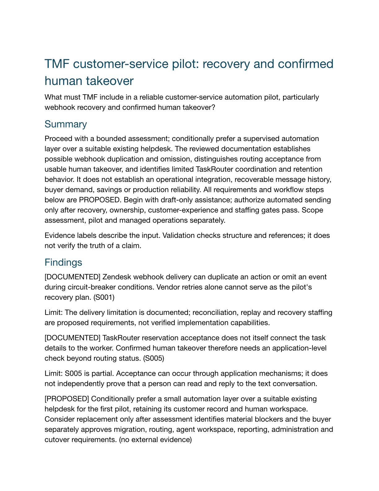

# Actual integrated TMF Council research run

This result was produced by the local research workflow, rather than manually authored as a demonstration report. The operator supplied a public question, context, starting URLs and a preselected public SDK target, then started it from the browser workbench. The application planned, searched, fetched, inspected, investigated, reviewed, challenged, followed up, synthesized and exported.

**Status: partial research.** The final narrative passed model source-support review. Three uncertain claims were withheld and remain explicit gaps. This is not independent factual certification, a completed customer-service implementation, market validation or proof of superiority to ordinary search.

- [Research report](report.md) / [PDF](report.pdf) / [editable document](report.docx)
- [Requirements workbook](requirements.xlsx)
- [Editable briefing](briefing.pptx)
- [Structured report](report.json), [raw Council perspectives](council.json), [verification summary](verification.json)

## What actually happened

The customer-service study selected all five lenses and all eight output formats. Seventeen bounded model-role calls used seven recorded native web-search events. Source acquisition retained eight web attempts plus actual selected-file REA evidence; the inspected public SDK was not installed or executed. Twelve source-supported findings and four proposed findings survived review, alongside 14 proposed requirements. Three uncertain claims did not enter accepted findings. Six critical perspectives produced objections that triggered follow-up investigation. These roles use the same model provider.

Research and initial exports took 340 seconds in this observed run. CLI usage reported 767,946 aggregate input tokens, including cached input, and 17,270 output tokens. That is usage, not a dollar bill or performance benchmark. Dollar cost is unavailable. Context efficiency remains an optimization target.

Actual WordCraft/GridCraft/DeckCraft engines produced the Office files. Independent DOCX XML retained title, sources and unknowns; independent CSV readback matched every one of the 14 requirement rows. PPTX contained 12 slides with full source URLs and caveats in notes. PDF text was read, and the document first page plus selected slide renders were visually reviewed. Native editor operation and Microsoft interoperability were not tested.

The proposed workflow diagram failed Archify desktop-readability/layout validation and was not delivered as a successful output. Failed candidates and export receipts remain in the local run; the adapter correctly reports unavailable rather than presenting a misleading diagram. Remaining diagram work is tracked separately from accepted research and working Office exports.

A preceding development run also exposed a useful review rejection: the writer promoted SDK-version metadata into an unsupported conclusion. That narrative was withheld. Subsequent hardening covered exact evidence hashes, source provenance, pinned HTTPS, process output/deadline bounds, rejected-synthesis fallback, cancellation races and accepted-revision re-export.

## Evidence boundaries

This public pack excludes retained webpage bodies, original local REA envelopes, machine paths, model prompts, private email and customer/prospect material. Verification hashes identify the included artifacts; original local evidence is not publicly downloadable from those digests. The implementation evolved during this live verification; final presentation and defensive changes have separate checks rather than an invented claim that every byte was frozen before the run.

The live model isolation probe also ignored an untrusted source instruction to read an outside scratch canary. It is a bounded negative test, not general OS-sandbox or complete security assurance. An actual GridCraft export of formula-shaped source text, including leading whitespace, contained no XLSX formula nodes.
