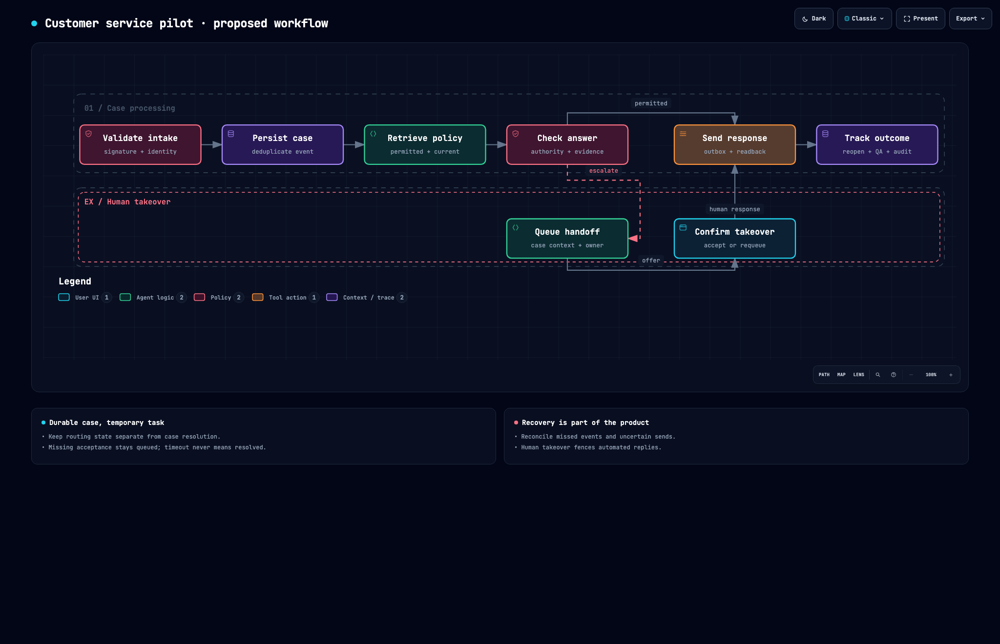

# A real research job: customer-service automation

**Verdict: useful for discovery and build planning; autonomous research remains missing.**

This operator-assisted study asks what TMF needs to offer a premium customer-service automation pilot. Seven official documentation sources and selected shipped Twilio SDK modules inform ten findings and 32 proposed requirements. It uses generic service design, with no private customer, email or prospect material.

## Read the result

- [Service blueprint](BLUEPRINT.md) / [PDF](blueprint.pdf) / [editable Word document](blueprint.docx): offer, scope, records, lifecycle, integration contracts, recovery, acceptance, operating costs and delivery sequence.
- [Requirements workbook](requirements.xlsx) / [CSV](requirements.csv): 32 requirements with priority, basis and acceptance conditions. Every requirement remains proposed, not implemented.
- [Briefing PDF](briefing.pdf) / [editable presentation](briefing.pptx): 12 slides covering the offer, findings, limits and next decisions.
- [Interactive workflow](workflow.html): download and open locally. Proposed workflow, not a running service.
- [Evidence report](evidence-report.md) / [HTML](evidence-report.html) / [structured record](report.json): citations, evidence states and explicit unknowns.
- [REA inspection review](rea-review.json): acquisition hashes, selected files, original evidence digest, review observations and coverage limitations. This is a sanitized derivative; original evidence remains local.



## What the exercise exposed

A routing task cannot be the only durable record of the customer's problem. Human takeover needs confirmed acceptance, not just an offer. Comment visibility must be explicit. Duplicate/missing events, concurrency conflicts and uncertain sends need designed recovery. These are substantive build requirements, not presentation polish. Vendor facts and proposed responses are separated in the evidence report.

The likely initial offer is an assessment followed by a narrow, supervised text-channel pilot. Voice, payments and a full helpdesk replacement need additional research and scope. No buyer interviews, verified pricing, customer demand or service deployment are claimed.

## What actually ran

| Step | Evidence and limit |
| --- | --- |
| Source research | Operator reviewed selected official documentation using web tools; no automatic source acquisition in the project |
| Software breakdown | Actual REA 6.7.0 parsed two selected Twilio Node 6.2.0 release modules; 37 graph nodes / 44 relationships. Registry archive integrity matched; SDK not installed or executed |
| Evidence handling | Existing project CLI imported original REA evidence conservatively, validated the study record and rendered Markdown/HTML |
| Office exports | Actual WordCraft/GridCraft/DeckCraft 0.8.0 CLIs generated the document, workbook, slides and PDFs |
| Content readback | WordCraft saved text; all 32 CSV requirement rows independently matched JSON; GridCraft formula returned 32; PPTX XML confirmed 12 slides and limitations |
| PDF and visual checks | Both PDF text exports read; document first page and slides 1/10 viewed. Archify showcase 9/9 checks, zero composition errors/warnings; desktop browser containment passed at 1440×900, 1600×1000, 1920×1080 and 2048×1320; largest dark capture viewed |
| Core regression | 12 existing report tests passed |

[Export receipt](export-receipt.json) pins source and six Office artifact hashes. It verifies these generated files, not customer-service acceptance. Vendor pages were reviewed live; immutable webpage snapshots and a second independent semantic reviewer were not part of this run. Native GUI editing, actual Microsoft interoperability, provider sandbox operations and production service delivery remain untested.

An initial local Python HTTPS acquisition failed because of its certificate store; acquisition was retried through system curl with TLS verification intact. Failed local logs were retained. No credentials or vendor accounts were needed.

## Reproduce presentation export

Supply separately acquired Craft CLI executables; this script does not download or install them. The study is reviewed input, not arbitrary untrusted spreadsheet content.

```bash
python3 -m tmf_research validate examples/customer-service-study/report.json
python3 scripts/export_study.py \
  --report examples/customer-service-study/report.json \
  --blueprint examples/customer-service-study/BLUEPRINT.md \
  --wordcraft /path/to/wordcraft-cli \
  --gridcraft /path/to/gridcraft-cli \
  --deckcraft /path/to/deckcraft-cli \
  --output runs/customer-service-pack
```

The output directory must be new. Receipt hashes describe generated bytes; Office metadata can change across exports. REA's original envelope digest identifies retained local evidence, not a publicly downloadable proof file. The release URL and selected-file hashes in the review permit a fresh inspection.

## Judgment against the intended job

| Question | Result |
| --- | --- |
| Does it uncover hidden implementation work? | Yes: concrete routing, identity, visibility, recovery and operations requirements |
| Can builders use it? | For discovery and backlog formation; provider mapping and client-specific decisions remain open |
| Can a buyer understand the proposed service? | Offer, scope, exclusions and costs model are explicit; buyer validation is still needed |
| Can outputs be reused? | Editable DOCX/XLSX/PPTX, PDF, MD, HTML and diagram generated and read back |
| Did the tool research autonomously? | No. Source selection, reading, synthesis and claim review were operator work |
| Is the service ready to sell as implemented? | No. There is no customer-service implementation or acceptance evidence |

The next core capability should connect bounded source acquisition, provenance, investigation and claim review to this existing evidence/export path. More output formats will not close that gap.
